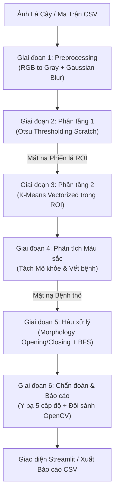

# 🍃 Hệ Thống Chẩn Đoán Mức Độ Bệnh & Đánh Giá Sức Khỏe Lá Cây Tự Động
### Automated Multi-Stage Plant Leaf Health Assessment System

[](https://www.python.org/)
[](#)
[](#)
[](tests/)

Dự án nghiên cứu và phát triển phần mềm thị giác máy tính phục vụ nông nghiệp thông minh: Tự động phân đoạn đa tầng, phát hiện đốm bệnh hoại tử, đếm số lượng ổ bệnh, tính tỷ lệ phần trăm diện tích tổn thương và chẩn đoán mức độ bệnh theo thang chuẩn 5 cấp độ y bạ cây trồng.

---

## 📋 Mục lục
1. [Kiến trúc hệ thống đa tầng](#1-kiến-trúc-hệ-thống-đa-tầng)
2. [Cấu trúc mã nguồn](#2-cấu-trúc-mã-nguồn)
3. [Quy chuẩn giao tiếp dữ liệu (Data Contracts)](#3-quy-chuẩn-giao-tiếp-dữ-liệu-data-contracts)
4. [Quy tắc phát triển Code From Scratch](#4-quy-tắc-phát-triển-code-from-scratch)
5. [Quy trình làm việc với Git & Pull Request](#5-quy-trình-làm-việc-với-git--pull-request)
6. [Hướng dẫn cài đặt & Thực thi](#6-hướng-dẫn-cài-đặt--thực-thi)

---

## 1. Kiến trúc hệ thống đa tầng

Hệ thống được thiết kế theo luồng xử lý 6 giai đoạn nối tiếp (Multi-stage Pipeline):



---

## 2. Cấu trúc mã nguồn

```text
Plant-Leaf-Health-Assessment/
├── README.md                       # Tài liệu tổng quan kiến trúc, Data Contracts và Git Workflow
├── requirements.txt                # Danh mục thư viện phụ thuộc
├── .gitignore                      # Cấu hình bỏ qua file nhị phân, cache và output
├── data/
│   ├── raw/                        # Thư mục lưu ảnh mẫu và file CSV ma trận đầu vào (.gitkeep)
│   └── outputs/                    # Thư mục lưu ảnh phân đoạn và kết quả xuất ra (.gitkeep)
├── src/
│   ├── __init__.py                 # Khởi tạo package src
│   ├── adapter.py                  # Cầu nối K-means → phân loại tổn thương độc lập
│   ├── data_io.py                  # Đọc/lưu ảnh và chuyển đổi ma trận CSV hai chiều
│   ├── preprocess.py               # Chuyển đổi RGB sang Gray/HSV, lọc Gauss và Mean scratch
│   ├── otsu.py                     # Thuật toán phân ngưỡng tự động Otsu 256 mức xám scratch
│   ├── kmeans.py                   # Thuật toán phân cụm K-means vector hóa bằng NumPy scratch
│   ├── color_clustering.py         # Phân tích đặc trưng màu tâm cụm tách mô lá và vết bệnh
│   ├── postprocess.py              # Hình thái học nhị phân (Erosion, Dilation) & BFS đếm ổ bệnh
│   ├── benchmark.py                # Đo IoU, Dice, PSNR, chẩn đoán 5 cấp độ bệnh và đối sánh OpenCV
│   └── pipeline.py                 # Điều phối tích hợp toàn trình (End-to-End Pipeline)
├── tests/
│   ├── __init__.py
│   ├── test_contracts.py           # Bộ kiểm thử tự động Data Contracts (kiểu, shape, runtime)
│   ├── test_segmentation_*.py      # Kiểm thử K-means, phân loại màu và adapter
│   ├── test_kmeans_survey.py
│   └── test_pipeline_h1_h2_integration.py
├── experiments/                   # Khảo sát K-means độc lập
│   ├── __init__.py
│   └── kmeans_survey.py            # So sánh RGB/HSV/Lab với K=2..5
└── app.py                          # Ứng dụng Streamlit trực quan hóa tương tác
```

---

Các thuật toán phân đoạn dùng `src.kmeans` và `src.color_clustering` theo cấu
trúc phẳng của main. `src.adapter.segment_leaf` kết nối hai module để khảo sát
độc lập, giữ nguyên các kênh đặc trưng và phân loại ba trạng thái
`disease_mask`, `healthy_mask`, `uncertain_mask`. Pipeline sử dụng các module
chuẩn này; các tầng chưa triển khai vẫn dùng fallback hiện có.
Pipeline giữ kết quả H2 trước fusion trong `cluster_color_result`, bao gồm
`uncertain_mask` và metadata. `color_result` vẫn là kết quả fusion Lab/MAD;
benchmark tiếp tục đối sánh scratch với OpenCV theo kiến trúc của main.

Chạy từ thư mục gốc repository:

```powershell
python -m pytest -q
python -m experiments.kmeans_survey --help
python -m experiments.kmeans_survey --synthetic --output data/outputs/survey_run001
python -m streamlit run app.py
```

## 3. Quy chuẩn giao tiếp dữ liệu (Data Contracts)

Tất cả các module chức năng phải tuân thủ nghiêm ngặt các quy ước kiểu dữ liệu (`dtype`), kích thước (`shape`) và miền giá trị đầu vào/đầu ra:

| Module | Hàm | Đầu vào (Input) | Đầu ra (Output) | Ghi chú quy chuẩn |
| :--- | :--- | :--- | :--- | :--- |
| `src/data_io.py` | `load_image_or_csv` | `file_source` (str/Path/bytes) | `np.ndarray` `(H, W, 3)` hoặc `(H, W)` | `uint8` [0..255], giữ thứ tự RGB |
| `src/data_io.py` | `save_matrix_to_csv` | `matrix_2d: np.ndarray` `(H, W)` | `None` | Xuất ra file định dạng CSV chuẩn |
| `src/preprocess.py` | `rgb_to_gray_scratch` | `rgb_img: (H, W, 3)` `uint8` | `(H, W)` `uint8` [0..255] | Công thức độ chói ITU-R BT.601 |
| `src/preprocess.py` | `rgb_to_hsv_scratch` | `rgb_img: (H, W, 3)` `uint8` | `(H, W, 3)` `uint8` [0..255] | Chuẩn hóa H, S, V về thang [0..255] |
| `src/preprocess.py` | `gaussian_filter_scratch` | `img: (H, W)` hoặc `(H, W, C)` | Giữ nguyên shape `uint8` | Tích chập 2D tự viết, tổng kernel = 1.0 |
| `src/otsu.py` | `compute_histogram_scratch` | `gray_img: (H, W)`, `roi_mask` | `(256,)` `int64` | Tần suất xuất hiện mức sáng 0..255 |
| `src/otsu.py` | `otsu_threshold_scratch` | `gray_img: (H, W)` `uint8` | `Dict[str, Any]` | `threshold` (int), `binary_mask` {0, 255}, `variance_curve` (256,) |
| `src/kmeans.py` | `kmeans_scratch` | `img: (H, W, C)`, `k: int`, `roi_mask` | `Dict[str, Any]` | `segmented_img` (uint8), `labels_2d` (int32), `centroids` (float32) |
| `src/color_clustering.py` | `extract_disease_and_healthy_masks` | `rgb_img`, `labels_2d`, `centroids` | `Dict[str, Any]` | `disease_mask` {0, 255}, `healthy_mask` {0, 255}, `disease_cluster_ids` |
| `src/postprocess.py` | `opening_scratch` / `closing_scratch` | `mask: (H, W)` `uint8` {0, 255} | `(H, W)` `uint8` {0, 255} | Khử đốm gai và lấp lỗ hổng |
| `src/postprocess.py` | `connected_components_bfs_scratch` | `mask: (H, W)`, `min_area: int` | `Dict[str, Any]` | `cleaned_mask`, `num_lesions` (int), `bboxes` `(x, y, w, h, area)` |
| `src/benchmark.py` | `compute_segmentation_metrics_scratch` | `pred_mask`, `ref_mask` {0, 255} | `Dict[str, float]` | `iou`, `dice`, `precision`, `recall`, `accuracy` trong [0.0, 1.0] |
| `src/benchmark.py` | `diagnose_leaf_severity` | `leaf_mask`, `disease_mask`, `num_lesions` | `Dict[str, Any]` | `severity_level` (0-4), `disease_ratio_percent`, `recommendation` |

---

## 4. Quy tắc phát triển Code From Scratch

Nhằm phục vụ mục đích học thuật và nắm vững bản chất toán học của môn Xử lý ảnh:
1. **NGHIÊM CẤM** gọi các hàm xử lý ảnh có sẵn của OpenCV (`cv2.cvtColor`, `cv2.GaussianBlur`, `cv2.threshold`, `cv2.kmeans`, `cv2.morphologyEx`, `cv2.connectedComponentsWithStats`) trong các module thuật toán tự code.
2. OpenCV chỉ được phép sử dụng ở:
   - Module `src/benchmark.py` (`run_opencv_otsu`, `run_opencv_kmeans`) để tạo mốc so sánh hiệu năng (baseline đối chứng).
   - Đọc/ghi ảnh cơ bản trong `src/data_io.py`.
   - Công cụ thực nghiệm `experiments/kmeans_survey.py`: chuyển RGB/HSV/Lab, đọc/ghi ảnh và vẽ bảng so sánh.
3. Tận dụng triệt để sức mạnh **vector hóa của NumPy (Broadcasting, ufunc)** để tối ưu tốc độ tính toán, đảm bảo thời gian phân cụm K-means không vượt quá 2-3 giây trên ảnh 512x512.

---

## 5. Quy trình làm việc với Git & Pull Request

Để đảm bảo nhánh `main` luôn hoạt động ổn định, các thành viên thực hiện nghiêm ngặt quy trình:

```text
[main] ---> Tạo nhánh [feat/ten-module] ---> Code & Tự kiểm thử [pytest] ---> Tạo Pull Request ---> Review & Merge
```

### Bước 1: Clone kho mã nguồn và tạo nhánh tính năng
```bash
git clone https://github.com/namnguyen05-vn/Plant-Leaf-Health-Assessment.git
cd Plant-Leaf-Health-Assessment
git checkout -b feat/<ten-tinh-nang>
```
*Ví dụ đặt tên nhánh chuẩn:*
- `feat/data-io`
- `feat/preprocess`
- `feat/otsu`
- `feat/kmeans`
- `feat/color-clustering`
- `feat/postprocess`
- `feat/benchmark`

### Bước 2: Cài đặt và kiểm tra cú pháp
Trước khi commit, đảm bảo code không có lỗi cú pháp Python:
```bash
python -m compileall src tests app.py
```

### Bước 3: Chạy bộ kiểm thử tự động Data Contracts
Trước khi gửi Pull Request, chạy bộ kiểm thử để xác nhận code đã đáp ứng 100% hợp đồng dữ liệu:
```bash
pytest tests/test_contracts.py -v
```

### Bước 4: Commit và đẩy nhánh lên GitHub
```bash
git add .
git commit -m "feat(<module>): implement <ten-chuc-nang> from scratch with numpy"
git push -u origin feat/<ten-tinh-nang>
```

### Bước 5: Tạo Pull Request (PR) về nhánh `main`
Nhóm trưởng sẽ kéo nhánh về kiểm tra lại với `pytest tests/test_contracts.py`, đối sánh kết quả với OpenCV benchmark trước khi chính thức chấp thuận merge vào `main`.

---

## 6. Hướng dẫn cài đặt & Thực thi

### 6.1. Thiết lập môi trường ảo Python
Khuyến nghị sử dụng Python 3.10 trở lên:
```bash
# Tạo môi trường ảo
python -m venv .venv

# Kích hoạt trên Windows PowerShell:
.venv\Scripts\Activate.ps1

# Cài đặt các gói thư viện cần thiết:
pip install -r requirements.txt
```

### 6.2. Chạy giao diện Web trực quan Streamlit
Khởi động ứng dụng phân tích sức khỏe lá cây:
```bash
streamlit run app.py
```
Ứng dụng sẽ tự động mở trên trình duyệt tại địa chỉ: `http://localhost:8501`.

### 6.3. Chạy bộ kiểm thử tự động
```bash
pytest tests/test_contracts.py -v
```
*(Ngay trong giai đoạn Skeleton, các bài kiểm thử cho các hàm chưa cài đặt sẽ tự động hiển thị trạng thái `SKIPPED` một cách an toàn mà không làm sập chương trình).*
